# Diagramium skill — editable, animated diagrams from any AI assistant

Ask your assistant for a diagram and get a **file you can open, edit,
present and narrate** — not a flat picture. This skill teaches Claude (and
other agents that read [Agent Skills](https://agentskills.io)) to write
[Diagramium](https://www.diagramium.com) documents: 27 diagram types, 46
themes, and an optional spoken script so the diagram explains itself step by
step.

> "Draw how OAuth sign-in works, hand-drawn style, with narration."

…produces `oauth-sign-in.json`. Open **https://www.diagramium.com/flow**,
choose **Menu → File → Open…** (or drag the file onto the canvas), press
**Explain**: a pencil draws each step while a
voice walks through it. Then edit anything, or export PNG, SVG, PDF, GIF,
animated SVG or a narrated video. Free, no account, and the diagram never
leaves your device.

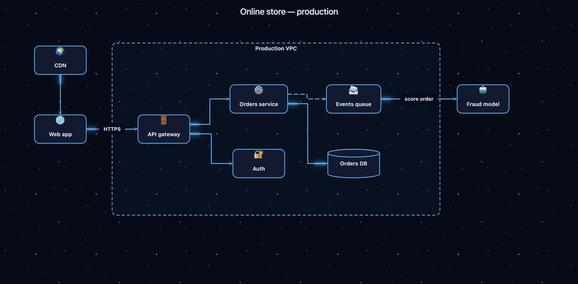

## Why a file, not an image

A generated image is a dead end: you cannot fix a typo, move a box, change
the theme or present it. A Diagramium file is the diagram's source — every
shape stays editable, it plays back step by step, and it carries its own
narration.

## What it can make

| | | |
|---|---|---|
| Flowchart · Process map · BPMN | Swimlane · Kanban · State machine | Sequence diagram |
| System architecture · C4 model | Data flow · Network · Threat model | UML class · ER diagram · Use case |
| Mind map · Concept map | Fishbone · Decision tree · Venn | Org chart · Sitemap |
| Timeline · Gantt chart | Customer journey map | Visual lesson · Visual story |

Themes range from clean professional (Quartz, Executive Navy, Bento) and
dark engineering (Obsidian, Linear Midnight, Glassmorphism) to animated
experiences: a pencil that draws every line (Doodle), a whiteboard marker
(Marker), a train that delivers each step (Metro Map), a terminal that types
the diagram in (Terminal), modules docking in space (Mission Control).

## Gallery

Every image below is one of the files in
[`examples/`](skills/diagramium-diagrams/examples), exported by Diagramium.

| | | |
|---|---|---|
| 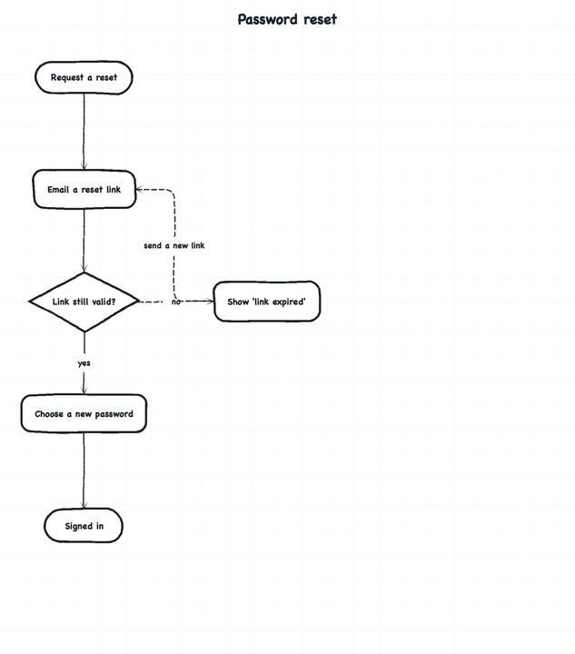 Flowchart · Doodle | 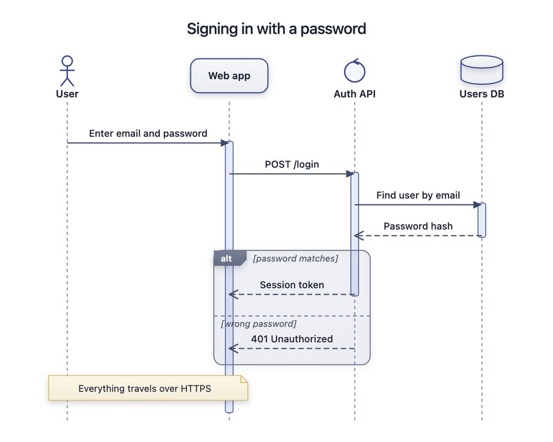 Sequence · Quartz | 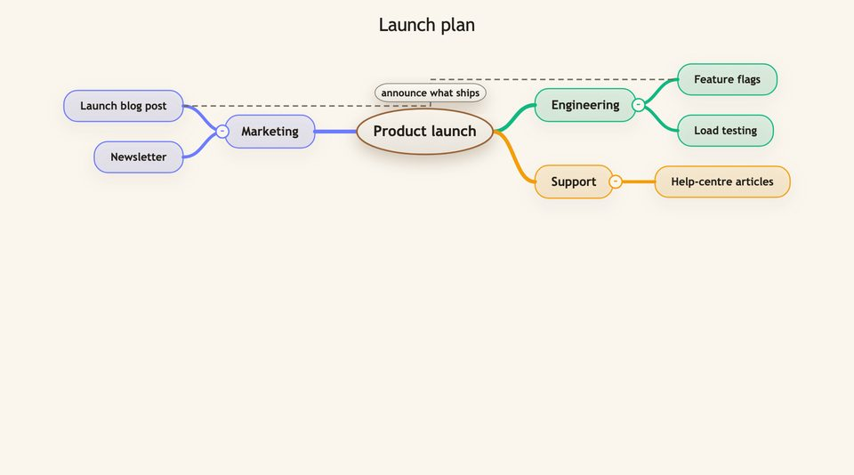 Mind map · Canvas |
| 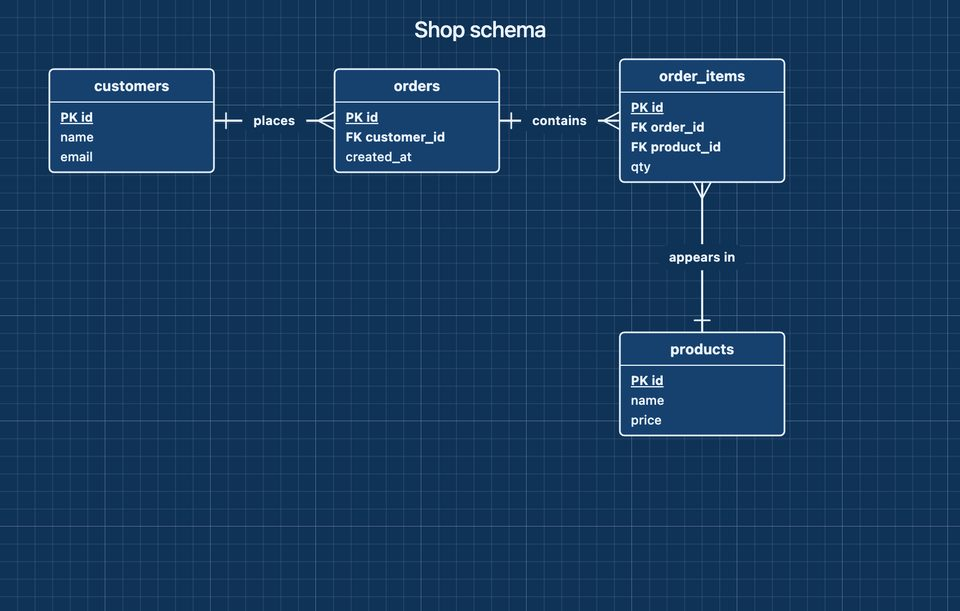 ER diagram · Blueprint Atelier | 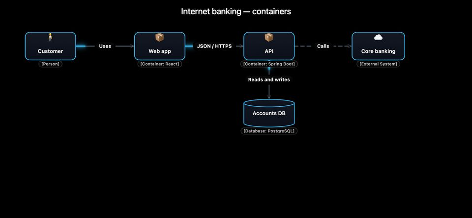 C4 · Linear Midnight | 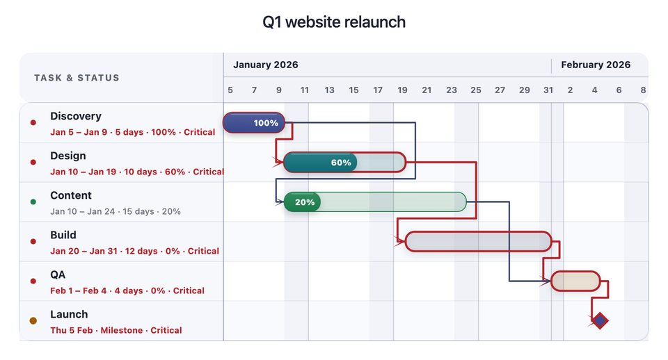 Gantt · Quartz |
| 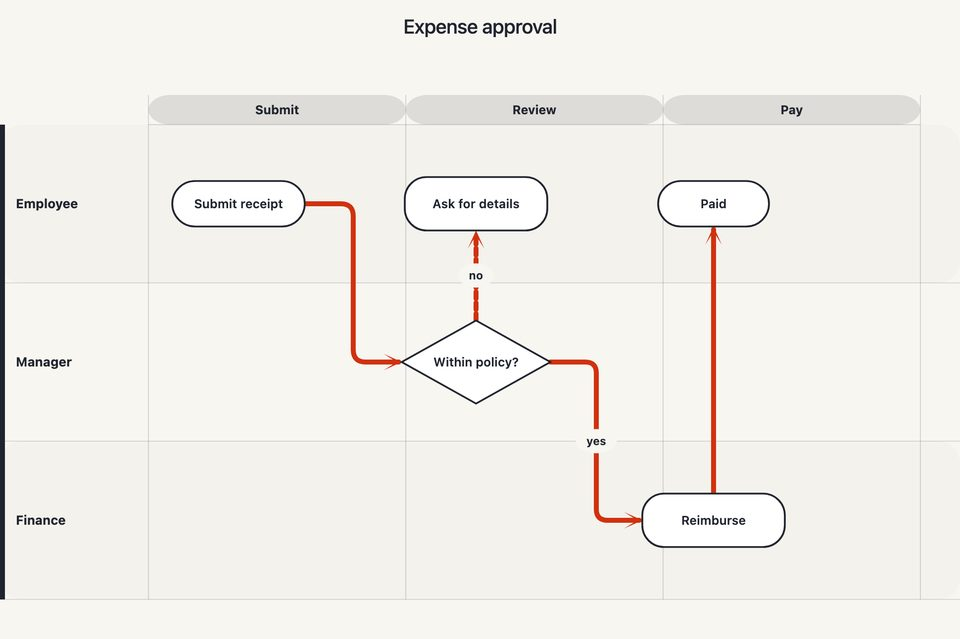 Swimlane · Metro Map | 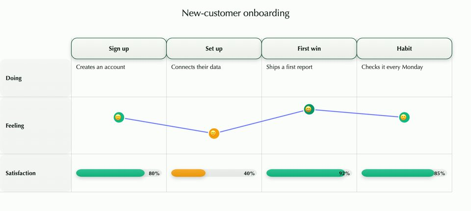 Journey map · Forest |  Venn · Glassmorphism |
| 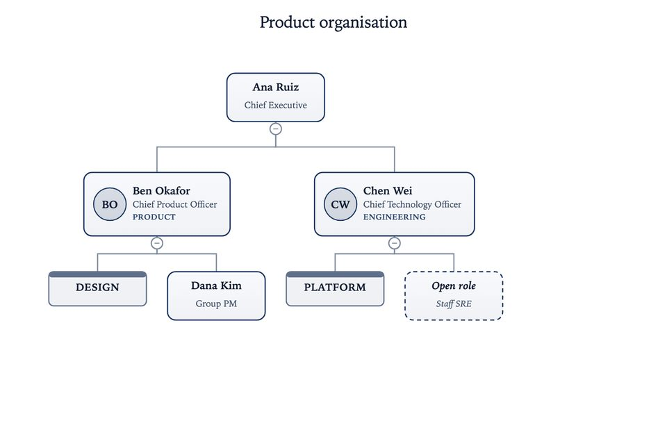 Org chart · Executive | 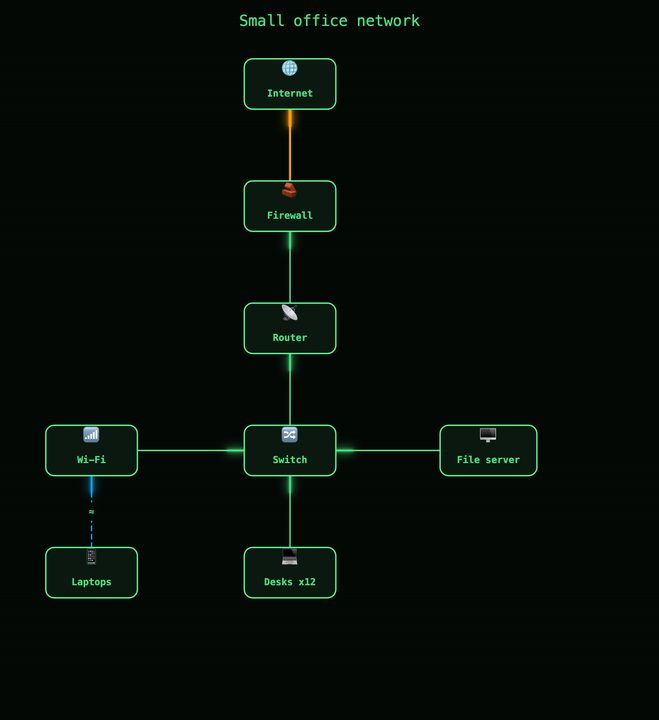 Network · Terminal | 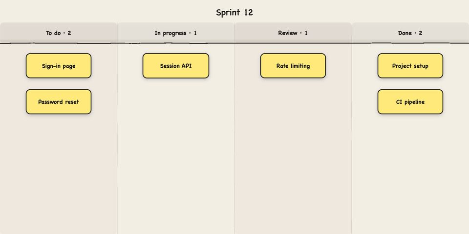 Kanban · Sticky Notes |

## Install

### Claude Code

```text
/plugin marketplace add diagramium/diagramium-skill
/plugin install diagramium@diagramium
```

Or copy the skill folder yourself:

```bash
git clone https://github.com/diagramium/diagramium-skill
cp -r diagramium-skill/skills/diagramium-diagrams ~/.claude/skills/
```

### Claude.ai and the Claude desktop app

1. Download `diagramium-diagrams.zip` from the
   [latest release](https://github.com/diagramium/diagramium-skill/releases/latest).
2. **Settings → Capabilities → Skills → Upload skill**, and choose the zip.
   (Code execution must be on, which it is by default.)

### Other agents

Any agent that reads the Agent Skills format can use
`skills/diagramium-diagrams/` as is — copy it into that agent's skills
directory. For ChatGPT, [`chatgpt/`](chatgpt) has the instructions and
knowledge files for a Custom GPT.

## Use it

Just ask for a diagram — you do not need to name the skill:

- "Map our checkout flow as a swimlane: customer, web app, payments, warehouse."
- "Turn this SQL schema into an ER diagram." *(paste the schema)*
- "A mind map of everything we need for the product launch."
- "Explain how HTTPS works as a visual lesson for beginners, with narration."
- "Our org chart, executive theme." *(paste the list)*

The assistant asks whether you want narration if your request does not make
it clear, checks the file with the bundled validator, and tells you how to
open it.

## What's inside

```text
skills/diagramium-diagrams/
├── SKILL.md              the workflow the assistant follows
├── references/
│   ├── modes.md          exact schema for all 27 diagram types
│   ├── themes.md         all 46 themes and what they do in Explain
│   └── format.md         shared fields, narration, pictures, bundled voice
├── examples/             one tested file per diagram type
└── scripts/validate.py   offline checker (Python standard library)
```

Check any file yourself:

```bash
python3 skills/diagramium-diagrams/scripts/validate.py my-diagram.json
```

## Privacy

The skill runs entirely inside your assistant; it calls nothing. Diagramium
itself has no accounts and collects nothing — your diagram is opened in your
browser and stays there. See the
[Diagramium privacy policy](https://www.diagramium.com/pages/privacy.html).

## Contributing

Issues and pull requests are welcome — especially a diagram the skill got
wrong (attach the file and what you asked for). See
[CONTRIBUTING.md](CONTRIBUTING.md).

## Licence

The skill — instructions, references, examples and scripts — is
[MIT](LICENSE) © 2026 DhuRee Labs Inc. Diagramium and the Diagramium logo
are trademarks of DhuRee Labs Inc.; the editor at diagramium.com is free to
use under its own [Terms of Use](https://www.diagramium.com/pages/terms.html).
The open-source player that renders these files elsewhere is
[diagramium-player](https://github.com/diagramium/diagramium-player).
